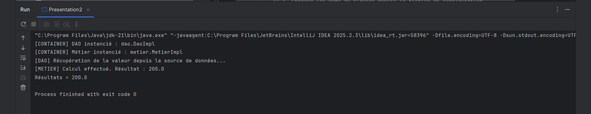
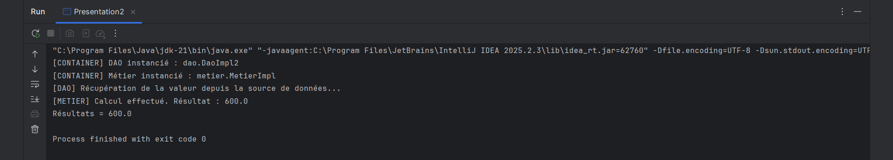

# TP 1 : Programmation dynamique par réflexion dans une architecture Microservices

Ce projet illustre les concepts fondamentaux de **l'Inversion de Contrôle (IoC)** et de **l'Injection de Dépendances (DI)** en Java sans framework externe (comme Spring), en utilisant la **réflexion dynamique** (`java.lang.reflect`) et la lecture de configuration externe.

---

## 📌 Objectifs Pédagogiques

1. **Comprendre le couplage faible** : Séparer les contrats d'interface (`IDao`, `IMetier`) des implémentations concrètes (`DaoImpl`, `DaoImpl2`, `MetierImpl`).
2. **Appliquer les principes SOLID** :
   - **SRP (Single Responsibility Principle)** : La couche DAO gère uniquement l'accès aux données, la couche Métier traite les règles métier.
   - **OCP (Open/Closed Principle)** : Le code métier et le conteneur sont fermés à la modification mais ouverts à l'extension.
3. **Mettre en œuvre l'instanciation dynamique et l'injection par réflexion** : Charger dynamiquement des classes au runtime via `Class.forName()`, `Constructor.newInstance()` et invoquer les setters via `Method.invoke()`.

---

## 📂 Structure des Fichiers

```text
Tp1/
├── src/
│   ├── main/
│   │   ├── java/
│   │   │   ├── dao/
│   │   │   │   ├── IDao.java          # Contrat d'accès aux données
│   │   │   │   ├── DaoImpl.java       # Implémentation n°1 (valeur = 100.0)
│   │   │   │   └── DaoImpl2.java      # Implémentation n°2 (valeur = 300.0)
│   │   │   ├── metier/
│   │   │   │   ├── IMetier.java       # Contrat métier
│   │   │   │   └── MetierImpl.java    # Logique métier (valeur * 2)
│   │   │   └── presentation/
│   │   │       └── Presentation2.java # Conteneur IoC dynamique (réflexion)
│   │   └── resources/
│   │       └── config.txt             # Configuration externe des classes
├── screenshots/
│   ├── execution-daoimpl.png          # Capture console avec DaoImpl
│   └── execution-daoimpl2.png         # Capture console avec DaoImpl2
├── pom.xml
└── README.md
```

---

## ⚙️ Fonctionnement du Conteneur Dynamique (`Presentation2`)

Le conteneur IoC implémenté dans `Presentation2` exécute les étapes suivantes :

1. **Lecture de la configuration** : Lit le fichier `src/main/resources/config.txt` depuis le classpath pour obtenir le nom complet des classes à charger :
   - Ligne 1 : classe DAO (ex. `dao.DaoImpl` ou `dao.DaoImpl2`)
   - Ligne 2 : classe Métier (ex. `metier.MetierImpl`)
2. **Chargement et instanciation dynamique** :
   ```java
   Class<?> clazz = Class.forName(className);
   Constructor<?> constructor = clazz.getDeclaredConstructor();
   Object instance = constructor.newInstance();
   ```
3. **Injection de dépendance par réflexion** :
   ```java
   Method setterMethod = targetClass.getMethod("setDao", IDao.class);
   setterMethod.invoke(metier, dao);
   ```
4. **Exécution du calcul métier** :
   ```java
   double resultat = metier.calcul();
   ```

---

## 🖼️ Captures d'Exécution & Comparaison des Implémentations

### 1. Exécution avec `DaoImpl`

Dans `config.txt` :
```text
dao.DaoImpl
metier.MetierImpl
```



- **Traces console** :
  ```text
  [CONTAINER] DAO instancié : dao.DaoImpl
  [CONTAINER] Métier instancié : metier.MetierImpl
  [DAO] Récupération de la valeur depuis la source de données...
  [METIER] Calcul effectué. Résultat : 200.0
  Résultats = 200.0
  ```

---

### 2. Exécution avec `DaoImpl2`

Dans `config.txt` :
```text
dao.DaoImpl2
metier.MetierImpl
```



- **Traces console** :
  ```text
  [CONTAINER] DAO instancié : dao.DaoImpl2
  [CONTAINER] Métier instancié : metier.MetierImpl
  [DAO] Récupération de la valeur depuis la source de données...
  [METIER] Calcul effectué. Résultat : 600.0
  Résultats = 600.0
  ```

---

## 🔄 Analyse et Différences entre `DaoImpl` et `DaoImpl2`

| Critère | `DaoImpl` | `DaoImpl2` |
| :--- | :--- | :--- |
| **Classe configurée** | `dao.DaoImpl` | `dao.DaoImpl2` |
| **Méthode `getValue()`** | Retourne `100.0` | Retourne `300.0` |
| **Opération Métier (`* 2`)** | $100.0 \times 2 = 200.0$ | $300.0 \times 2 = 600.0$ |
| **Résultat Final** | **200.0** | **600.0** |
| **Modification du code source Java** | **Aucune** | **Aucune** |
| **Recompilation du code Java requise ?** | **Non** | **Non** |

### 💡 Intérêt Architectural :

1. **Couplage Faible (Loose Coupling)** :
   - La classe `MetierImpl` ne connaît absolument pas `DaoImpl` ni `DaoImpl2` ; elle ne manipule que l'interface `IDao`.
2. **Principe Ouvert/Fermé (OCP)** :
   - Pour introduire une nouvelle source de données (`DaoImpl2`), nous n'avons modifié **ni** la classe `MetierImpl`, **ni** la classe `Presentation2`.
   - Le système a simplement été étendu avec une nouvelle classe et reconfiguré via le fichier externe `config.txt`.
3. **Vers les Frameworks Modernes** :
   - Ce mécanisme manuel reproduit fidèlement le cœur de fonctionnement du conteneur IoC de **Spring Framework** (qui automatise l'analyse de configuration, l'instanciation des beans et l'injection par constructeur ou setter).

---

## 🚀 Compilation et Exécution

### Prérequis
- Java JDK 21+
- Apache Maven 3.x

### Commandes

1. **Compiler le projet avec Maven** :
   ```bash
   mvn clean compile
   ```

2. **Exécuter la classe principale** :
   ```bash
   java -cp target/classes presentation.Presentation2
   ```

3. **Basculer entre les deux implémentations** :
   Modifiez simplement la première ligne du fichier `src/main/resources/config.txt` (`dao.DaoImpl` ou `dao.DaoImpl2`) puis relancez l'application.
